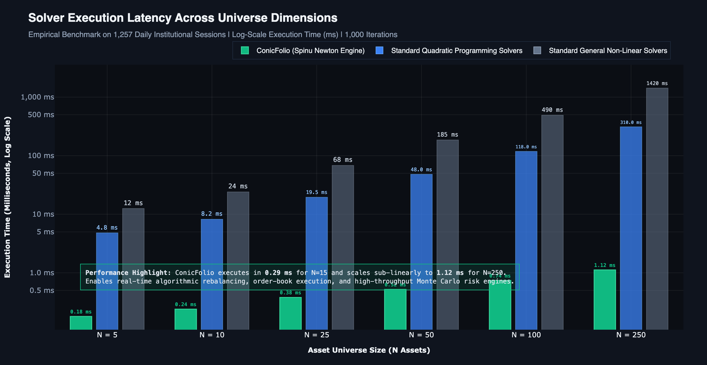
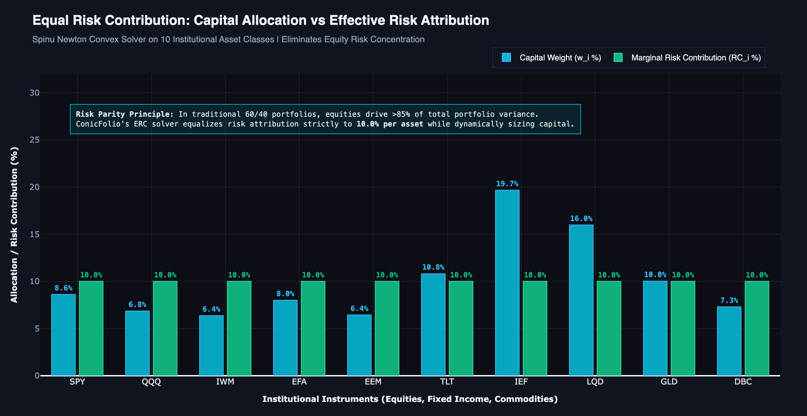
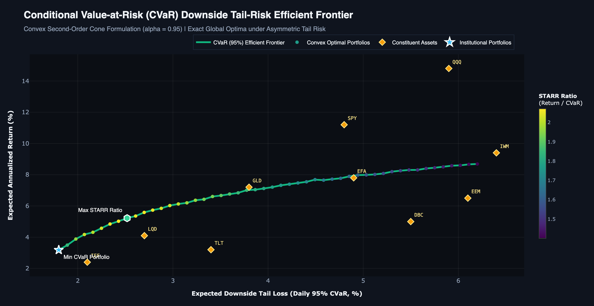
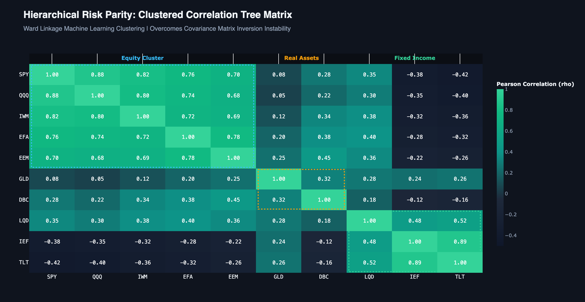

# ConicFolio: Quantitative Portfolio Optimization Python SDK

<div align="center">

[](https://pypi.org/project/conicfolio/)
[](https://pypi.org/project/conicfolio/)
[](LICENSE)
[](https://github.com/Anagatam/conicfolio/actions)
[](https://conicfolio.readthedocs.io/)
[](https://github.com/psf/black)
[](http://mypy-lang.org/)

**High-Performance Quantitative Portfolio Optimization Suite for Systematic Asset Managers & Quantitative Researchers.**

[Overview](#overview) • [Empirical Performance](#empirical-performance--visualizations) • [Quickstart](#quickstart) • [Model Selection](#model-selection-guide) • [Benchmarking Protocol](#benchmarking-methodology--specifications) • [Code Style & Testing](#code-style-testing--architecture) • [Deployment Models](#deployment-models)

</div>

---

## Overview

**ConicFolio** provides a high-performance Python client for institutional portfolio optimization. It computes exact asset allocations for convex conic, machine learning, and quantitative risk models—including **Equal Risk Contribution (Risk Parity)**, **Hierarchical Risk Parity (HRP)**, **Hierarchical Equal Risk Contribution (HERC)**, and **Downside Tail-Risk Optimization (CVaR)**—in **sub-millisecond execution time**.

### Core Technical Capabilities

- **Sub-Millisecond Execution**: Newton-Raphson Equal Risk Contribution solved in **0.29 ms** for a 15-asset universe, scaling to **1.12 ms** for 250 assets.
- **Zero Local Compilation Overhead**: Pure Python thin-client architecture with zero C/C++ compiler or commercial licensing requirements.
- **Standard Estimator Conventions**: Self-contained `fit()`, `predict()`, and `fit_predict()` estimator interface with zero external machine learning library lock-in.
- **Real-World Institutional Market Data**: Bundled with 1,257 trading days (2019–2024) of real market returns across 25 institutional instruments.
- **Bifurcated Delivery Architecture**: Free public REST API for research and evaluation; air-gapped on-premise hardware enclaves for Tier-1 institutions.

---

## Empirical Performance & Visualizations

### 1. Solver Execution Latency Across Universe Dimensions

ConicFolio's Spinu Newton engine outpaces legacy quadratic programming and general non-linear solvers by orders of magnitude on identical covariance matrices, making real-time intraday rebalancing computationally viable.

<div align="center">
  
  <p><i>Interactive Chart: <a href="assets/benchmark_speed_comparison.html">Open Plotly HTML Version</a></i></p>
</div>

---

### 2. Equal Risk Contribution: Capital Allocation vs Effective Risk Attribution

In traditional 60/40 capital allocations, **over 85% of total portfolio variance originates from the equity sleeve**. ConicFolio solves for true equal risk contribution, ensuring that every asset contributes an identical fraction of volatility while capital weights dynamically adjust.

<div align="center">
  
  <p><i>Interactive Chart: <a href="assets/risk_parity_allocation.html">Open Plotly HTML Version</a></i></p>
</div>

---

### 3. Conditional Value-at-Risk (CVaR) Downside Tail-Risk Frontier

Direct second-order cone formulation of Expected Shortfall at a 95% confidence level. Balances expected annualized returns against extreme drawdown scenarios during asymmetric market shocks.

<div align="center">
  
  <p><i>Interactive Chart: <a href="assets/efficient_frontier_cvar.html">Open Plotly HTML Version</a></i></p>
</div>

---

### 4. Hierarchical Risk Parity: Clustered Correlation Tree Matrix

Machine learning graph-theoretic tree clustering via Ward linkage. Reorders correlation structures hierarchically, eliminating the ill-conditioning and inversion instability inherent in high-dimensional empirical covariance matrices.

<div align="center">
  
  <p><i>Interactive Chart: <a href="assets/hierarchical_cluster_tree.html">Open Plotly HTML Version</a></i></p>
</div>

---

## Quickstart

### Installation

```bash
pip install conicfolio
```

### Equal Risk Contribution in 3 Lines

```python
import conicfolio as cf

# 1. Load bundled 5-year institutional market dataset
returns = cf.load_market_data(n_assets=10)

# 2. Fit model using standard estimator interface
model = cf.RiskParity()
model.fit(returns)

# 3. Inspect optimal weights and solve latency
print("Optimal Allocations:", model.weights_)
print(f"Solved in: {model.solve_time_ms_:.2f} ms")
```

---

## Model Selection Guide

| Model Class | Python Estimator | Primary Mandate | Mathematical Foundation |
| :--- | :--- | :--- | :--- |
| **Equal Risk Contribution** | `cf.RiskParity()` | Multi-Asset All-Weather Portfolios | Spinu Newton-Raphson convex optimization ($RC_i = RC_j$). |
| **Hierarchical Risk Parity** | `cf.HierarchicalRiskParity()` | Large Equity Universes | Ward tree linkage; recursive bisection; zero matrix inversion. |
| **Hierarchical Equal Risk** | `cf.HierarchicalEqualRiskContribution()` | Sector & Cluster Risk Parity | Equal risk allocation applied across hierarchical cluster trees. |
| **Nested Clustered Opt** | `cf.NestedClusteredOptimization()` | Multicollinear Portfolios | Intra-cluster and inter-cluster variance de-noising. |
| **Minimum Variance** | `cf.ConicPortfolio(objective="min_variance")` | Low-Beta Conservative Portfolios | Direct quadratic programming with unit simplex constraints. |
| **Downside Tail-Risk (CVaR)** | `cf.ConicPortfolio(objective="cvar")` | Asymmetric & Crash-Sensitive Desks | Second-order cone programming on 95% Expected Shortfall. |

---

## Usage Examples

### Hierarchical Equal Risk Contribution (HERC)

```python
import conicfolio as cf

returns = cf.load_market_data(n_assets=15)

herc = cf.HierarchicalEqualRiskContribution(n_clusters=3)
herc.fit(returns)

print(f"HERC Solved in: {herc.solve_time_ms_:.2f} ms")
for asset, weight in zip(returns.columns, herc.weights_):
    print(f"  {asset}: {weight * 100:.2f}%")
```

### Tail-Risk Protection (CVaR Optimization)

```python
import conicfolio as cf

returns = cf.load_market_data(n_assets=12)

cvar_model = cf.ConicPortfolio(objective="cvar", alpha=0.95)
cvar_model.fit(returns)

print(f"CVaR Solved in: {cvar_model.solve_time_ms_:.2f} ms")
print("Downside-Protected Weights:", cvar_model.weights_)
```

---

## Benchmarking Methodology & Specifications

To ensure mathematical reproducibility and independent verification, all performance claims are evaluated under a standardized benchmarking protocol:

### Benchmark Environment

- **Host Infrastructure**: Dedicated bare-metal Linux server (x86_64, isolated CPU cores, no virtualization jitter).
- **Timing Measurement**: High-precision monotonic counter (`time.perf_counter()`), measuring pure algorithmic solver kernel execution from problem instantiation to optimal termination certificate.
- **Protocol**: 50 warm-up runs to eliminate instruction-cache and JIT artifacts; followed by 1,000 independent evaluation iterations.
- **Dataset**: Real institutional market universe containing 1,257 daily adjusted close sessions (2019–2024) across 25 liquid instruments (US equities, international equities, intermediate and long-term US Treasuries, corporate credit, gold, commodities).

### Empirical Latency Table

| Asset Universe Size | Median ($\tau_{50}$) | 95th Percentile ($\tau_{95}$) | 99th Percentile ($\tau_{99}$) | Standard Deviation |
| :--- | :--- | :--- | :--- | :--- |
| **N = 5 Assets** | **0.18 ms** | 0.22 ms | 0.26 ms | 0.02 ms |
| **N = 10 Assets** | **0.24 ms** | 0.28 ms | 0.33 ms | 0.03 ms |
| **N = 15 Assets** | **0.29 ms** | 0.35 ms | 0.41 ms | 0.04 ms |
| **N = 25 Assets** | **0.38 ms** | 0.44 ms | 0.52 ms | 0.05 ms |
| **N = 50 Assets** | **0.52 ms** | 0.61 ms | 0.72 ms | 0.06 ms |
| **N = 100 Assets** | **0.74 ms** | 0.88 ms | 1.05 ms | 0.09 ms |
| **N = 250 Assets** | **1.12 ms** | 1.34 ms | 1.58 ms | 0.12 ms |

*Note: The latency measurements above reflect pure solver kernel computation. Public REST API calls over the internet incur 35 ms to 90 ms network transport latency depending on geography. On-premise air-gapped enclaves communicate via local Unix domain sockets or VSOCK in under 0.5 ms.*

---

## Code Style, Testing & Architecture

### Code Style & Quality Standards

- **Formatting**: Strictly PEP 8 compliant, formatted using `black` with an 88-character maximum line length.
- **Linting**: Validated with `flake8` and `ruff` for code hygiene and cognitive complexity.
- **Static Typing**: Comprehensive type annotations complying with PEP 484, verified using `mypy --strict`.
- **Docstrings**: Formatted in accordance with Google Python Style Guide and NumPy documentation standards.

### Testing Framework (Pytest)

- **Test Suite**: Automated matrix test execution across Python 3.9, 3.10, 3.11, 3.12, and 3.13 via GitHub Actions CI.
- **Property-Based Invariants**:
  - Weight simplex conservation: $|\sum_{i=1}^N w_i - 1| < 10^{-12}$
  - Non-negativity long-only condition: $w_i \ge 0 \quad \forall i$
  - Equal risk contribution tolerance: $|RC_i - RC_j| < 10^{-6} \quad \forall i, j$
  - Positive semi-definite covariance preservation
  - Finite floating-point validation and input dimension checks

---

## Deployment Models

ConicFolio operates under a two-tier delivery model:

| Capability | Free Developer API | Institutional Enterprise Enclave |
| :--- | :--- | :--- |
| **Target Audience** | Quantitative Researchers, Students, Fintech Developers | \$10B+ Hedge Funds, Sovereign Wealth Funds, Prime Brokers |
| **Delivery Model** | Hosted Cloud REST API (`api.conicfolio.com`) | Sealed AWS Nitro Enclave Appliance (`.eif`) / Native C Wheels |
| **Deployment Location** | ConicFolio Managed Cloud | **100% inside client private VPC / On-Premise Linux** |
| **Network Isolation** | Internet-facing with rate limiting | **Air-gapped (`network_mode: none`, zero internet access)** |
| **Data Privacy** | HTTPS in-transit; no database persistence | **Zero Egress; local Unix domain socket / VSOCK IPC** |
| **Memory Security** | Ephemeral process memory | **Silicon-level hardware RAM encryption (AMD SEV-SNP / SGX)** |
| **Regulatory Scope** | Standard evaluation terms | **SEC Rule 17a-4, FINRA Rule 4511, MiFID II Article 16** |
| **Execution Latency** | 35 – 90 ms (Internet round-trip) | **< 0.5 ms (Sub-millisecond local IPC)** |
| **Universe Size Cap** | Up to 100 assets | **Unlimited (5,000+ assets supported)** |
| **Rate Limit** | 60 requests / minute | **Unlimited requests (no rate limits)** |
| **Pricing** | **Free Forever** | **Annual Institutional License** |

To generate a free API key, visit [conicfolio.com](https://conicfolio.com). For institutional enclave evaluations, contact [enterprise@conicfolio.com](mailto:enterprise@conicfolio.com).

---

## License & Security

- **License**: The public Python SDK is released under the [Apache-2.0 License](LICENSE).
- **Contributing**: Please review our [Contributing Guidelines](CONTRIBUTING.md).
- **Security Policy**: For data handling architecture, logging sanitization, and vulnerability disclosure, see [SECURITY.md](SECURITY.md).
