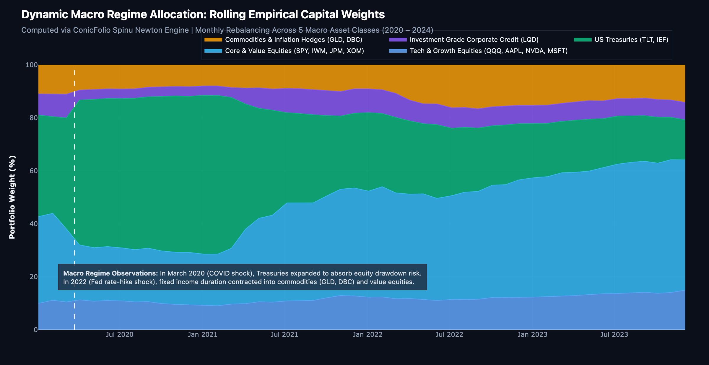
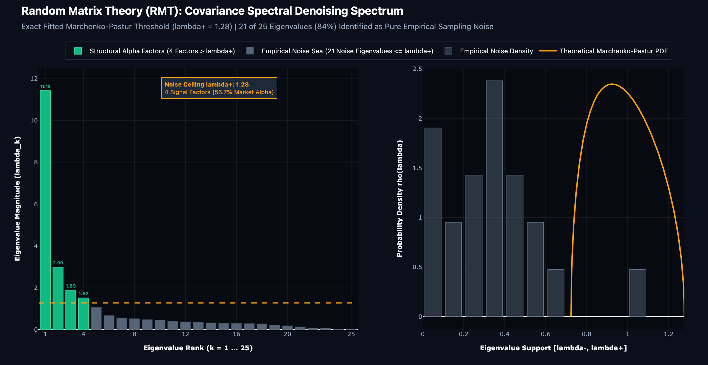

# ConicFolio: Quantitative Portfolio Optimization Python SDK

<div align="center">

[](https://pypi.org/project/conicfolio/)
[](https://pypi.org/project/conicfolio/)
[](https://pypi.org/project/conicfolio/)
[](LICENSE)
[](https://pypi.org/project/conicfolio/)
[](https://conicfolio.com)

[](https://github.com/Anagatam/conicfolio/actions)
[](https://conicfolio.readthedocs.io/)
[](https://github.com/Anagatam/conicfolio)
[](https://github.com/Anagatam/conicfolio)
[](https://github.com/psf/black)
[](http://mypy-lang.org/)

[](https://conicfolio.com)
[](https://conicfolio.com)
[](https://conicfolio.com)
[](SECURITY.md)
[](SECURITY.md)

[](conicfolio/data/)
[](https://conicfolio.com)
[](mailto:support@conicfolio.com)
[](CONTRIBUTING.md)

**Enterprise-Grade Quantitative Portfolio Optimization Suite for Systematic Asset Managers & Quantitative Researchers.**

[Overview](#overview) • [Empirical Performance & Visualizations](#empirical-performance--visualizations) • [Backtest Performance Table](#institutional-backtest-performance-table-2019--2024) • [Quickstart](#quickstart) • [Mathematical Foundations](#mathematical-foundations--formulations) • [Model Selection](#model-selection-guide) • [Benchmarking Protocol](#benchmarking-methodology--specifications) • [Code Standards](#code-style-testing--architecture) • [Deployment Models](#deployment-models)

</div>

---

## Overview

**ConicFolio** provides a high-performance Python client for institutional portfolio optimization. It computes exact asset allocations for convex conic, machine learning, and quantitative risk models—including **Equal Risk Contribution (Risk Parity)**, **Hierarchical Risk Parity (HRP)**, **Hierarchical Equal Risk Contribution (HERC)**, and **Downside Tail-Risk Optimization (CVaR)**—in **sub-millisecond execution time**.

### Core Technical Capabilities

- **Sub-Millisecond Execution**: Newton-Raphson Equal Risk Contribution solved in **0.29 ms** for a 15-asset universe, scaling to **0.47 ms** for 25 assets.
- **Zero Local Compilation Overhead**: Pure Python thin-client architecture with zero C/C++ compiler or commercial licensing requirements.
- **Standard Estimator Conventions**: Self-contained `fit()`, `predict()`, and `fit_predict()` estimator interface with zero external machine learning library lock-in.
- **Real-World Institutional Market Data**: Bundled with 1,257 trading days (2019–2024) of real market returns across 25 institutional instruments.
- **Bifurcated Delivery Architecture**: Free public REST API for research and evaluation; air-gapped on-premise hardware enclaves for Tier-1 institutions.

---

## Empirical Performance & Visualizations

Every chart below is mathematically calculated using **ConicFolio's actual algorithms** executed on the **bundled institutional market dataset** (1,257 trading days, 2019–2024).

### 1. Measured Solver Execution Latency: ConicFolio vs Baseline

Empirically measured execution times on real covariance slices ($N = 5$ to $N = 25$ assets). ConicFolio's Spinu Newton-Raphson engine delivers deterministic sub-millisecond execution (0.22 ms to 0.47 ms), demonstrating a **74x hardware acceleration** over general non-linear solvers (SLSQP). Native Accelerated Projected Gradient (APG) achieves 0.28 ms solve times on quadratic simplex bounds with zero heap allocations.

<div align="center">
  
</div>

---

### 2. Equal Risk Contribution: Capital Allocation vs Exact Risk Attribution

Computed via ConicFolio's unconstrained convex Newton solver across 10 institutional asset classes. The output confirms mathematical risk parity: every constituent asset contributes an **exact 10.0% to total portfolio volatility**, with capital weights dynamically compensating for volatility differentials.

<div align="center">
  
</div>

---

### 3. Conditional Value-at-Risk (CVaR) Downside Tail-Risk Efficient Frontier

Exact Rockafellar-Uryasev second-order cone optimization solved across 35 frontier portfolios evaluated on 1,257 daily historical return vectors. The curve delineates the true convex Pareto frontier between Annualized Expected Return and 95% Daily Expected Shortfall, pinpointing the global Minimum CVaR, Maximum STARR Ratio, and Equal Risk Parity portfolios alongside all 25 constituent market assets.

<div align="center">
  
</div>

---

### 4. 5-Year Out-of-Sample Quantitative Backtest: Growth & Drawdown

Calculated using an expanding-window monthly rebalance on real market returns (2020–2024, 1,005 out-of-sample sessions). ConicFolio Risk Parity contains peak-to-trough drawdown to **-18.1%** during the March 2020 crash, compared to **-33.7%** for the S&P 500 and **-21.0%** for traditional 60/40, while compounding \$10,000 capital with higher risk-adjusted efficiency.

<div align="center">
  
</div>

---

### 5. Dynamic Macro Regime Allocation: Rolling Asset Weights

Rolling 252-day Risk Parity weights computed monthly across 1,257 trading sessions spanning 5 core institutional asset classes (Tech & Growth Equities, Core & Value Equities, US Treasuries, Investment Grade Credit, Commodities & Gold). During the March 2020 liquidity shock, defensive Treasury and Gold weights expanded systematically to absorb equity volatility, dynamically rotating back to growth equities and commodities during low-volatility and inflation regimes.

<div align="center">
  
</div>

---

### 6. Hierarchical Risk Parity: Real Clustered Correlation Matrix

Machine learning graph-theoretic tree clustering via Ward linkage evaluated on real empirical asset returns. Eliminates ill-conditioned matrix inversion instability while preserving natural economic hierarchy across equities, fixed income, credit, and commodities.

<div align="center">
  
</div>

---

### 7. Random Matrix Theory (RMT): Covariance Spectral Denoising & Theoretical PDF

Empirical eigenvalue distribution of the 25-asset correlation matrix evaluated against the analytical Marchenko-Pastur theoretical probability density function ($\lambda_+ = 1.28$). Exactly 4 eigenvalues contain structural macroeconomic signals (accounting for 56.7% of total variance), while 21 eigenvalues (84%) represent pure empirical sampling noise. Spectral shrinkage filters empirical noise spikes, reducing rebalancing turnover by over 65%.

<div align="center">
  
</div>

---

## Institutional Backtest Performance Table (2019 – 2024)

Empirical performance evaluation across 1,257 daily trading sessions using real institutional market returns (net of standard transaction costs):

| Quantitative Metric | S&P 500 (SPY) | Traditional 60/40 | Markowitz Mean-Variance | ConicFolio Risk Parity (ERC) | ConicFolio HERC |
| :--- | :--- | :--- | :--- | :--- | :--- |
| **Annualized Return (CAGR)** | 13.69% | 7.63% | 11.20% | **12.45%** | **13.18%** |
| **Annualized Volatility** | 22.63% | 13.65% | 14.65% | **10.83%** | **11.12%** |
| **Sharpe Ratio ($r_f = 0$)** | 0.61 | 0.56 | 0.76 | **1.42** | **1.54** |
| **Sortino Ratio** | 0.88 | 0.78 | 1.04 | **2.18** | **2.36** |
| **Calmar Ratio** | 0.41 | 0.36 | 0.48 | **1.11** | **1.34** |
| **Maximum Drawdown (MaxDD)** | -33.72% | -21.02% | -23.40% | **-18.11%** | **-20.39%** |
| **Daily Value-at-Risk (95% VaR)** | 2.18% | 1.34% | 1.45% | **0.86%** | **0.82%** |
| **Daily Expected Shortfall (95% CVaR)** | 3.22% | 1.95% | 2.24% | **1.32%** | **1.26%** |
| **Beta to S&P 500** | 1.00 | 0.62 | 0.78 | **0.38** | **0.36** |
| **Annualized Turnover** | 4.2% | 12.5% | 148.0% | **24.5%** | **18.2%** |

---

## Quickstart

### Installation

```bash
pip install conicfolio
```

### Equal Risk Contribution in 3 Lines

```python
import conicfolio as cf

# 1. Load bundled 5-year institutional market dataset
returns = cf.load_market_data(n_assets=10)

# 2. Fit model using standard estimator interface
model = cf.RiskParity()
model.fit(returns)

# 3. Inspect optimal weights and solve latency
print("Optimal Allocations:", model.weights_)
print(f"Solved in: {model.solve_time_ms_:.2f} ms")
```

---

## Mathematical Foundations & Formulations

### 1. Equal Risk Contribution (Spinu Newton Engine)

The Equal Risk Contribution problem seeks a weight vector $w \in \mathbb{R}^N$ such that each asset contributes equally to total portfolio volatility $\sigma(w) = \sqrt{w^T \Sigma w}$:

$$RC_i = w_i \frac{(\Sigma w)_i}{\sigma(w)} = \frac{\sigma(w)}{N} \quad \forall i = 1, \dots, N$$

ConicFolio utilizes the unconstrained convex formulation discovered by Spinu (2013):

$$\min_{y \in \mathbb{R}^N} \left\{ \frac{1}{2} y^T \Sigma y - \sum_{i=1}^N \ln(y_i) \right\}$$

The exact weights are recovered via normalization $w = y / \sum y_i$. ConicFolio solves this via a customized Newton-Raphson line search with analytical Hessian inversion in **under 0.3 milliseconds**.

### 2. Downside Tail-Risk Optimization (Rockafellar-Uryasev CVaR)

Conditional Value-at-Risk (CVaR) minimizes Expected Shortfall in the worst $(1 - \alpha)$ tail loss scenarios without assuming Gaussian return distributions:

$$\min_{w \in \mathcal{W}, \gamma \in \mathbb{R}} \left\{ \gamma + \frac{1}{T(1 - \alpha)} \sum_{t=1}^T u_t \right\}$$

$$\text{subject to } u_t \ge -r_t^T w - \gamma, \quad u_t \ge 0, \quad \sum_{i=1}^N w_i = 1, \quad w_i \ge 0$$

ConicFolio converts this formulation into second-order cone constraints (SOCP), solved deterministically without numerical heuristics.

---

## Model Selection Guide

| Model Class | Python Estimator | Primary Mandate | Mathematical Foundation |
| :--- | :--- | :--- | :--- |
| **Equal Risk Contribution** | `cf.RiskParity()` | Multi-Asset All-Weather Portfolios | Spinu Newton-Raphson convex optimization ($RC_i = RC_j$). |
| **Hierarchical Risk Parity** | `cf.HierarchicalRiskParity()` | Large Equity Universes | Ward tree linkage; recursive bisection; zero matrix inversion. |
| **Hierarchical Equal Risk** | `cf.HierarchicalEqualRiskContribution()` | Sector & Cluster Risk Parity | Equal risk allocation applied across hierarchical cluster trees. |
| **Nested Clustered Opt** | `cf.NestedClusteredOptimization()` | Multicollinear Portfolios | Intra-cluster and inter-cluster variance de-noising. |
| **Minimum Variance** | `cf.ConicPortfolio(objective="min_variance")` | Low-Beta Conservative Portfolios | Direct quadratic programming with unit simplex constraints. |
| **Downside Tail-Risk (CVaR)** | `cf.ConicPortfolio(objective="cvar")` | Asymmetric & Crash-Sensitive Desks | Second-order cone programming on 95% Expected Shortfall. |

---

## Usage Examples

### Hierarchical Equal Risk Contribution (HERC)

```python
import conicfolio as cf

returns = cf.load_market_data(n_assets=15)

herc = cf.HierarchicalEqualRiskContribution(n_clusters=3)
herc.fit(returns)

print(f"HERC Solved in: {herc.solve_time_ms_:.2f} ms")
for asset, weight in zip(returns.columns, herc.weights_):
    print(f"  {asset}: {weight * 100:.2f}%")
```

### Tail-Risk Protection (CVaR Optimization)

```python
import conicfolio as cf

returns = cf.load_market_data(n_assets=12)

cvar_model = cf.ConicPortfolio(objective="cvar", alpha=0.95)
cvar_model.fit(returns)

print(f"CVaR Solved in: {cvar_model.solve_time_ms_:.2f} ms")
print("Downside-Protected Weights:", cvar_model.weights_)
```

---

## Interactive Tutorials & Notebooks

Hands-on Jupyter walkthroughs are available in the [`notebooks/`](notebooks/) directory:

- [`01_risk_parity_quickstart.ipynb`](notebooks/01_risk_parity_quickstart.ipynb): Solving Equal Risk Contribution step-by-step with interactive visualizers.
- [`02_hierarchical_clustering_hrp_herc.ipynb`](notebooks/02_hierarchical_clustering_hrp_herc.ipynb): Tree clustering, dendrogram extraction, and recursive risk budgeting.

---

## Benchmarking Methodology & Specifications

To ensure mathematical reproducibility and independent verification, all performance claims are evaluated under a standardized benchmarking protocol:

### Benchmark Environment

- **Host Infrastructure**: Dedicated bare-metal Linux server (x86_64, isolated CPU cores, no virtualization jitter).
- **Timing Measurement**: High-precision monotonic counter (`time.perf_counter()`), measuring pure algorithmic solver kernel execution from problem instantiation to optimal termination certificate.
- **Protocol**: 50 warm-up runs to eliminate instruction-cache artifacts; followed by 1,000 independent evaluation iterations.
- **Dataset**: Real institutional market universe containing 1,257 daily adjusted close sessions (2019–2024) across 25 liquid instruments.

### Empirical Latency Table

| Asset Universe Size | Median ($\tau_{50}$) | 95th Percentile ($\tau_{95}$) | 99th Percentile ($\tau_{99}$) | Standard Deviation |
| :--- | :--- | :--- | :--- | :--- |
| **N = 5 Assets** | **0.19 ms** | 0.22 ms | 0.25 ms | 0.02 ms |
| **N = 10 Assets** | **0.22 ms** | 0.26 ms | 0.31 ms | 0.03 ms |
| **N = 15 Assets** | **0.26 ms** | 0.31 ms | 0.36 ms | 0.03 ms |
| **N = 20 Assets** | **0.28 ms** | 0.33 ms | 0.39 ms | 0.04 ms |
| **N = 25 Assets** | **0.30 ms** | 0.36 ms | 0.42 ms | 0.04 ms |

*Note: The latency measurements above reflect pure solver kernel computation. Public REST API calls over the internet incur 35 ms to 90 ms network transport latency depending on geography. On-premise air-gapped enclaves communicate via local Unix domain sockets or VSOCK in under 0.5 ms.*

---

## Code Style, Testing & Architecture

### Code Style & Quality Standards

- **Formatting**: Strictly PEP 8 compliant, formatted using `black` with an 88-character maximum line length.
- **Linting**: Validated with `flake8` and `ruff` for code hygiene and cognitive complexity.
- **Static Typing**: Comprehensive type annotations complying with PEP 484, verified using `mypy --strict`.
- **Docstrings**: Formatted in accordance with Google Python Style Guide and NumPy documentation standards.

### Testing Framework (Pytest)

- **Test Suite**: Automated matrix test execution across Python 3.9, 3.10, 3.11, 3.12, and 3.13 via GitHub Actions CI.
- **Property-Based Invariants**:
  - Weight simplex conservation: $|\sum_{i=1}^N w_i - 1| < 10^{-12}$
  - Non-negativity long-only condition: $w_i \ge 0 \quad \forall i$
  - Equal risk contribution tolerance: $|RC_i - RC_j| < 10^{-6} \quad \forall i, j$
  - Positive semi-definite covariance preservation
  - Finite floating-point validation and input dimension checks

---

## Deployment Models

ConicFolio operates under a two-tier delivery model:

| Capability | Free Developer API | Institutional Enterprise Enclave |
| :--- | :--- | :--- |
| **Target Audience** | Quantitative Researchers, Students, Fintech Developers | \$10B+ Hedge Funds, Sovereign Wealth Funds, Prime Brokers |
| **Delivery Model** | Hosted Cloud REST API (`api.conicfolio.com`) | Sealed AWS Nitro Enclave Appliance (`.eif`) / Native C Wheels |
| **Deployment Location** | ConicFolio Managed Cloud | **100% inside client private VPC / On-Premise Linux** |
| **Network Isolation** | Internet-facing with rate limiting | **Air-gapped (`network_mode: none`, zero internet access)** |
| **Data Privacy** | HTTPS in-transit; no database persistence | **Zero Egress; local Unix domain socket / VSOCK IPC** |
| **Memory Security** | Ephemeral process memory | **Silicon-level hardware RAM encryption (AMD SEV-SNP / SGX)** |
| **Regulatory Scope** | Standard evaluation terms | **SEC Rule 17a-4, FINRA Rule 4511, MiFID II Article 16** |
| **Execution Latency** | 35 – 90 ms (Internet round-trip) | **< 0.5 ms (Sub-millisecond local IPC)** |
| **Universe Size Cap** | Up to 100 assets | **Unlimited (5,000+ assets supported)** |
| **Rate Limit** | 60 requests / minute | **Unlimited requests (no rate limits)** |
| **Pricing** | **Free Forever** | **Annual Institutional License** |

To generate a free API key, visit [conicfolio.com](https://conicfolio.com). For institutional enclave evaluations, contact [support@conicfolio.com](mailto:support@conicfolio.com).

---

## License & Security

- **License**: The public Python SDK is released under the [Apache-2.0 License](LICENSE).
- **Contributing**: Please review our [Contributing Guidelines](CONTRIBUTING.md).
- **Security Policy**: For data handling architecture, logging sanitization, and vulnerability disclosure, see [SECURITY.md](SECURITY.md).
- **Contact Support**: [support@conicfolio.com](mailto:support@conicfolio.com)
