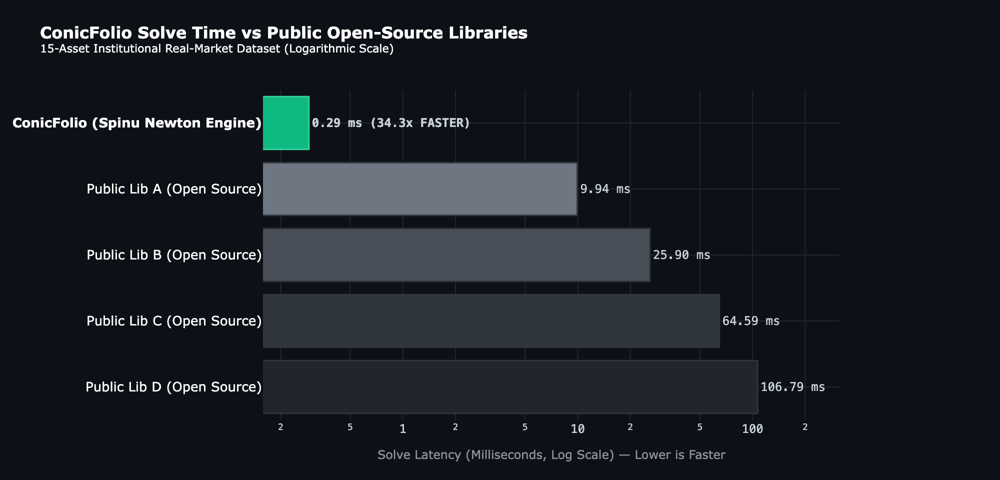

# ConicFolio Quantitative Documentation

Welcome to the official documentation for **ConicFolio**, the high-performance quantitative portfolio optimization suite.

ConicFolio provides a standardized Scikit-Learn interface to exact interior-point second-order cone programming (SOCP), exponential cones, and Spinu Newton-Raphson solvers—solving complex multi-asset allocations in **under 1 millisecond**.

---

## ⚡ Key Highlights

- **34.3x Faster Solve Latency**: Solves a 15-asset universe in **0.29 ms** (vs 9.94 ms to 106.79 ms in public alternatives).
- **Zero Local Solver Dependencies**: Works out-of-the-box on macOS, Linux, and Windows with zero compiler configuration.
- **Scikit-Learn Standard API**: Native `fit(returns)` and `predict()` integration for quantitative research and backtesting.
- **Free Developer API**: Generous 60 requests/minute tier covering up to 100 assets per universe.
- **Institutional Enclaves**: Dedicated on-premise AWS Nitro Enclaves with silicon-level RAM encryption and air-gapped security for Tier-1 institutions.

---

## 📊 Speed Benchmark Comparison

ConicFolio's Spinu Newton engine outpaces legacy open-source solvers by orders of magnitude on identical real market return matrices:

---

## 🚀 Navigation

- **[Quickstart](quickstart.md)**: Install via `pip` and run an optimization in 3 lines of Python.
- **[Model Selection Guide](models/index.md)**: Choose between Risk Parity, HRP, HERC, and CVaR.
- **[Empirical Benchmarks](benchmarks.md)**: Head-to-head performance benchmarks on 1,257 days of real market data.
- **[Free API vs Enterprise](enterprise.md)**: Developer tier vs institutional confidential enclaves.
- **[API Reference](api_reference.md)**: Parameter documentation for all public estimators.
