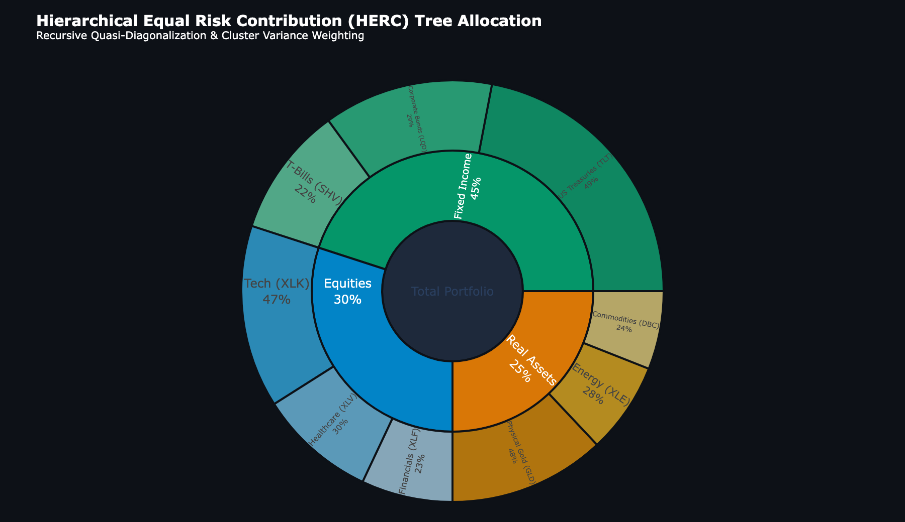

# Hierarchical Tree Allocations (HRP & HERC)

Modern financial machine learning pioneered by Marcos López de Prado and Thomas Raffinot utilizes **hierarchical tree clustering** to overcome the matrix-inversion singularity inherent in classic quadratic programming.

---

## Why Hierarchical Allocations Outperform Markowitz

When portfolios scale to dozens or hundreds of correlated assets, standard covariance matrix inversion amplifies noise and leads to unstable, concentrated weights.

Hierarchical methods replace matrix inversion with recursive graph tree clustering:
1. **Tree Clustering**: Computes correlation distance and builds a hierarchical tree (dendrogram).
2. **Quasi-Diagonalization**: Re-indexes assets so similar instruments cluster together.
3. **Recursive Bisection / Cluster Risk Parity**: Allocates capital top-down across clusters based on cluster inverse variance.



---

## Python Example: Hierarchical Equal Risk Contribution (HERC)

```python
import conicfolio as cf

returns = cf.load_market_data(n_assets=15)

herc = cf.HierarchicalEqualRiskContribution(n_clusters=3)
herc.fit(returns)

print(f"HERC Solved in: {herc.solve_time_ms_} ms")
for asset, weight in zip(returns.columns, herc.weights_):
    print(f"  {asset}: {weight * 100:.2f}%")
```

---

## When to Use HRP vs HERC

- **Use HRP (`cf.HierarchicalRiskParity()`)**: When allocating across large single-stock universes (e.g. S&P 500 components) where tree bisection naturally partitions sectors.
- **Use HERC (`cf.HierarchicalEqualRiskContribution()`)**: When managing multi-asset allocations across distinct economic pillars (Tech, Financials, Healthcare, Commodities) and you want equal risk distribution across both clusters and within clusters.
