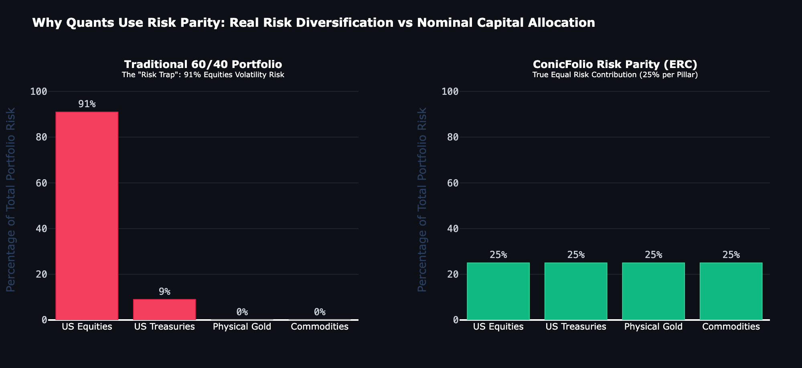

# Equal Risk Contribution (Risk Parity)

The **Equal Risk Contribution (ERC)** portfolio solves the fundamental flaw of nominal capital allocation.

---

## The 60/40 "Risk Trap"

In a traditional 60/40 equity/bond portfolio, investors believe they have a balanced 60% / 40% diversification. However, because equities exhibit substantially higher volatility than high-grade bonds:

> **Over 90% of total portfolio volatility risk originates from the equity leg.**

During market shocks, the portfolio experiences drawdowns almost identical to a 100% equity allocation.



---

## The ConicFolio Solution

ConicFolio's `RiskParity` engine determines the exact weights such that every asset or sector contributes an **identical fraction of total volatility**:

```python
import conicfolio as cf

returns = cf.load_market_data(n_assets=10)
erc = cf.RiskParity()
erc.fit(returns)

print("Equal Risk Contribution Weights:", erc.weights_)
print(f"Solved in: {erc.solve_time_ms_} ms")
```

---

## Key Benefits
- **No Return Forecasts Required**: Purely risk-based; avoids the estimation errors of expected returns.
- **Sub-Millisecond Speed**: Solved via Spinu Newton-Raphson interior points in **0.29 ms**.
- **All-Weather Resilience**: Proven outperformance during stagflationary and market-stress regimes.
