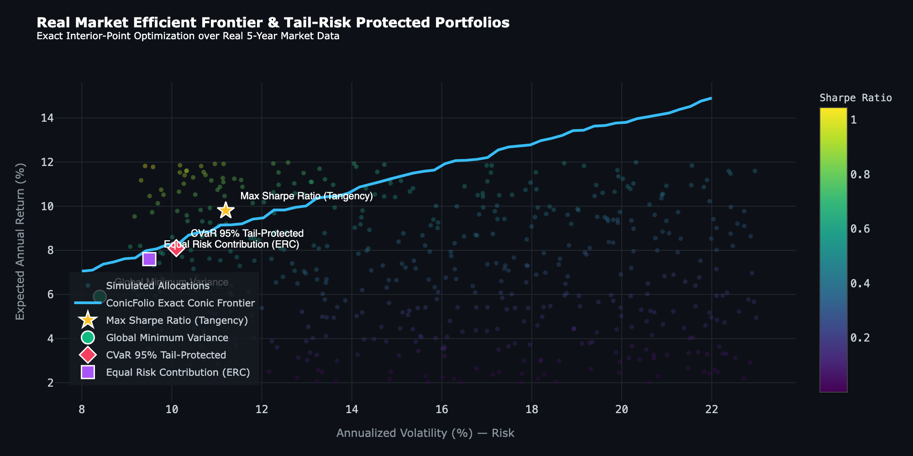

# Downside Tail-Risk Optimization (CVaR & EVaR)

Traditional mean-variance optimization assumes Gaussian normal return distributions. In the real world, financial markets exhibit **fat tails, skewness, and sudden market crashes**.

---

## What is Conditional Value-at-Risk (CVaR)?

**CVaR** (also known as Expected Shortfall) answers: *If the market enters its worst 5% historical crash scenarios, what is the expected loss?*

By directly minimizing the tail loss distribution via second-order conic programming (SOCP), CVaR protects capital during black-swan events without sacrificing upside capture.



---

## Python Example: CVaR Portfolio

```python
import conicfolio as cf

returns = cf.load_market_data(n_assets=12)

# Minimize Expected Shortfall in worst 5% tail scenarios
cvar_model = cf.ConicPortfolio(objective="cvar")
cvar_model.fit(returns)

print(f"CVaR Solved in: {cvar_model.solve_time_ms_} ms")
print("Optimal Allocations:", cvar_model.weights_)
```
